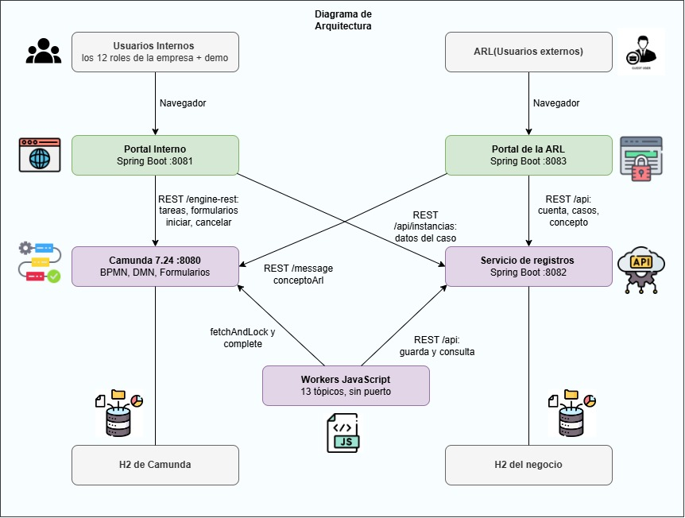

# UT-llano-Alianza Hub
Proyecto de Curso de Profundización Software 1

Este repo es la guía general del proyecto. Aquí están los enlaces a los demás repos, cómo se conectan, cómo se instala y en qué orden se prende todo, y las pruebas.
Cada parte del proyecto tiene su propio repo con su código y su README.

## Integrantes
- Laura Vanessa Hernandez Garcia 160004630
- Vivian Andrea Prado Zuleta 160004632
- Daniel Felipe Espinosa Alvarez 160004707

# Contexto

La Unión Temporal Llano Alianza tiene su sede principal en Bogotá y presta servicios de aseo y desinfección, cafetería, alimentación, fumigación y mano de obra a empresas públicas y privadas (outsourcing).

El problema es que los procesos se manejaban por correo, planillas y llamadas, entonces no se sabía en qué iba cada caso, quién lo tenía pendiente ni dónde quedaban los datos como los radicados, las novedades o el valor de las propuestas.

Lo que hicimos fue automatizar tres procesos con Camunda 7, con un portal para los usuarios de la empresa, un portal para la ARL (que es el usuario externo), workers para las tareas automáticas y una base de datos propia del negocio.

**Participantes internos:** trabajador, supervisor de sede, equipo investigador, analista de nómina, coordinador SST, coordinador operativo, gestión humana, facturación, asuntos legales, director de proyectos, área financiera y gerencia.
**Participante externo:** la ARL, que recibe la investigación de los accidentes graves y manda su concepto desde su portal.

# Procesos y responsables

## Proceso 1: Investigar y Reportar Accidente de Trabajo
**Responsable:** Laura Vanessa Hernandez Garcia
**Subproceso:** Investigar Accidente

## Proceso 2: Programar y Controlar Asistencia del Personal
**Responsable:** Daniel Felipe Espinosa Alvarez
**Subproceso:** Gestionar Personal Adicional

## Proceso 3: Elaborar Propuesta
**Responsable:** Vivian Andrea Prado Zuleta
**Subproceso:** Elaborar Propuesta Económica

## Responsables por componente
- Motor (BPMN, DMN y forms): cada uno el de su proceso
- Cambios en el repo del motor y corrección de la retroalimentación: Vivian Andrea Prado Zuleta
- Workers: Daniel Felipe Espinosa Alvarez
- Portal interno: Laura Vanessa Hernandez Garcia
- Portal de la ARL: Vivian Andrea Prado Zuleta
- Servicio de registros: Vivian Andrea Prado Zuleta
- Hub (integrador): Laura Vanessa Hernandez Garcia
- Diagrama de arquitectura: Daniel Felipe Espinosa Alvarez

## Alcance
- Los 3 procesos con sus subprocesos, DMN y forms corren en Camunda 7.24
- En el portal interno cada rol entra con su usuario, ve sus tareas, las completa y ve los datos guardados del caso
- En el portal de la ARL la ARL crea su cuenta, ve los casos que le mandaron y envía su concepto, que le llega al proceso como un mensaje
- El servicio de registros guarda accidentes, reportes, conceptos, matriz de riesgos, novedades, prefacturas y propuestas, cada uno con el id de su instancia en Camunda
- Hay 13 workers en JavaScript para las tareas automáticas, varios guardan datos en el servicio de registros y usan lo que este les responde (radicados, totales, valor de la propuesta)
- No hay correo real ni conexión real con SECOP II, la ARL o el Ministerio. Eso se representa con el portal de la ARL y con los workers

---

# Repos

- **Hub** (este repo): guía, arquitectura, base de datos, pruebas y scripts. https://github.com/vivian1143/ut-llano-alianza-hub
- **Motor** (UT-llano-Alianza): Camunda 7.24 en Spring Boot con los BPMN, DMN y forms. Puerto 8080. https://github.com/vivian1143/UT-llano-Alianza
- **Workers**: tareas automáticas en JavaScript. https://github.com/vivian1143/ut-llano-alianza-workers
- **Portal interno**: para los usuarios de la empresa. Puerto 8081. https://github.com/vivian1143/ut-llano-alianza-portal-interno
- **Servicio de registros**: base de datos del negocio. Puerto 8082. https://github.com/vivian1143/ut-llano-alianza-registros
- **Portal de la ARL**: para el usuario externo. Puerto 8083. https://github.com/vivian1143/ut-llano-alianza-portal-arl

# Arquitectura

Todo se comunica por API REST, ninguna parte toca la base de datos de otra.
Lo que hace cada parte está en docs/arquitectura.md y las tablas de la base de datos en docs/modeloDatos.md

---

# Requisitos
- Java 17
- IntelliJ (o Maven 3.9)
- Node.js 18 o más (para los workers, el script de usuarios y las pruebas)
- No se necesita Docker

# Puertos
- 8080: Camunda (Cockpit, Tasklist y la API en /engine-rest)
- 8081: portal interno
- 8082: servicio de registros (la API en /api y la consola de la base de datos en /h2-console)
- 8083: portal de la ARL
- Los workers no usan puerto, ellos le preguntan a Camunda si hay tareas

# Instalación
1. Clonar los 6 repos en una misma carpeta
2. En la carpeta de los workers colocar npm install
3. Los proyectos de Spring Boot bajan sus dependencias solos al abrirlos en IntelliJ

No hay que crear bases de datos, Camunda y el servicio de registros crean la suya la primera vez que arrancan.

# Cómo ejecutar
Cada uno en su propia terminal o pestaña de Run de IntelliJ, y esperar a que arranque antes de seguir con el otro:

1. **Motor:** en IntelliJ abrir Application.java, dar click derecho y Run. Queda en http://localhost:8080 (usuario demo y contraseña demo)
2. **Servicio de registros:** click derecho en RegistrosApplication.java y Run. Para ver que sí prendió entrar a http://localhost:8082/api
3. **Workers:** en otra terminal ir a la carpeta de los workers y colocar npm start, deben aparecer 13 mensajes "subscribed to topic"
4. **Portal interno:** click derecho en PortalApplication.java y Run. Queda en http://localhost:8081
5. **Portal de la ARL:** click derecho en PortalArlApplication.java y Run. Queda en http://localhost:8083

**Si se usa Camunda Run:** se despliegan las carpetas bpmn, dmn y forms del repo del motor y desde este repo se corre node scripts/crearUsuarios.js para crear los usuarios de cada rol

# Configuración
Si todo corre en el mismo computador no hay que cambiar nada. Si algo cambia de puerto, cada parte lee estas variables:
- Motor: server.port en application.yaml
- Workers: CAMUNDA_URL y REGISTROS_URL
- Portal interno: PUERTO, CAMUNDA_URL y REGISTROS_URL
- Servicio de registros: PUERTO y REGISTROS_DB_URL
- Portal de la ARL: PUERTO, CAMUNDA_URL y REGISTROS_URL

En la carpeta configuracion hay un archivo de ejemplo para cada uno.

# Usuarios

**Portal interno y Camunda** (la contraseña es igual al usuario)
- Accidente: trabajador, supervisor, sst, investigador, nomina
- Asistencia: coordinador, supervisor, gestionHumana, nomina, facturacion
- Propuesta: legal, proyectos, financiera, gerencia
- Administrador: demo (está en todos los grupos y es el único que puede cancelar procesos)

**Portal de la ARL**
- arl@demo.com con contraseña arl12345
- También se puede crear una cuenta nueva con "Crear cuenta"

---

# Recorrido completo (un accidente grave)
1. En el portal interno entrar como trabajador, dar click en "Reportar un accidente o incidente" y llenar Informar evento
2. supervisor completa Atender al trabajador. Ahí el worker notificarSst guarda el accidente en el servicio de registros
3. sst lo clasifica como accidente grave, la DMN decide reportar a la ARL y al Ministerio, y luego llena el FURAT con incapacidad. Los workers hacen los reportes y el servicio de registros devuelve los radicados
4. nomina registra la incapacidad, sst conforma el equipo e investigador hace las 3 tareas del subproceso
5. El worker remitirInvestigacionArl deja el caso listo para la ARL y el proceso se queda esperando el concepto o los 15 días
6. En el portal de la ARL (http://localhost:8083) entrar con arl@demo.com, abrir el caso y mandar el concepto
7. Volver al portal interno, sst ve Revisar concepto de ARL con lo que mandó la ARL y abajo del formulario salen los datos guardados del caso
8. sst, supervisor y sst terminan las acciones y el worker actualizarMatrizRiesgos cierra el caso en la base de datos
9. Para ver lo que quedó guardado entrar a http://localhost:8082/api/accidentes o a la consola http://localhost:8082/h2-console (JDBC URL jdbc:h2:file:./registros-db/registros, usuario sa y contraseña sa)

# Pruebas
Con todo prendido, en la carpeta de este repo colocar:

node pruebas/ejecutarPruebas.js

Son 12 casos con el camino principal, caminos alternativos y excepciones de los 3 procesos, más la validación de datos. Al final crea el archivo pruebas/resultados.md con lo que se esperaba y lo que salió en cada caso.
Para correr uno solo: node pruebas/ejecutarPruebas.js CP-05
Los casos están explicados en docs/casosPrueba.md

# Qué hay en este repo
- docs/arquitectura.md: qué hace cada parte y qué aplicación atiende cada carril de los procesos
- docs/modeloDatos.md: las tablas del servicio de registros
- docs/casosPrueba.md: los casos de prueba
- configuracion/: archivos de configuración de ejemplo
- scripts/crearUsuarios.js: crea los usuarios por rol en Camunda (sirve para Camunda Run)
- pruebas/ejecutarPruebas.js: las pruebas
