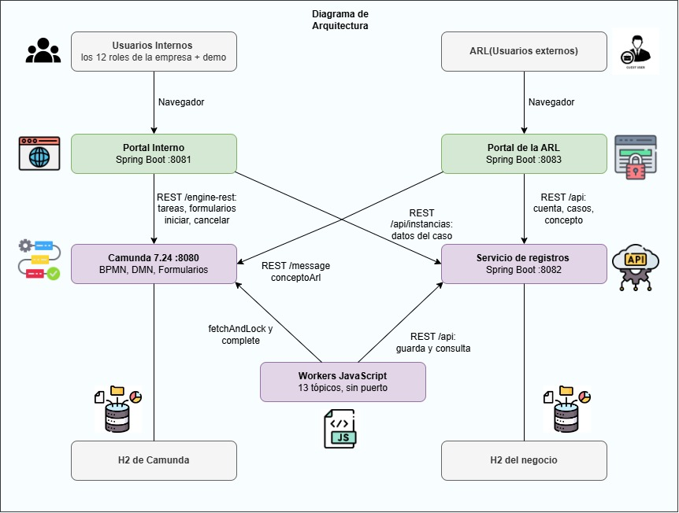

# Arquitectura

El sistema tiene seis piezas: un motor de procesos, dos aplicaciones web, un servicio con la base de datos del negocio, los workers y este hub con la guía. Ninguna aplicación toca la base de datos de otra: todo se habla por API REST.

## Componentes

### Motor (ut-llano-alianza-camunda, puerto 8080)
- Camunda 7.24 embebido en Spring Boot 3.5.6.
- Despliega solo al arrancar los 6 BPMN, las 3 tablas DMN y los 37 formularios Camunda Forms.
- Crea los 12 grupos y usuarios por rol (clase UsuariosYGruposConfig).
- Guarda las definiciones, instancias, tareas e historial en su propia base H2 (archivo `camunda-h2-database`).
- Expone la API REST en `/engine-rest`, que es la única puerta de entrada para los demás componentes.
- No tiene código de tareas automáticas: todas las tareas de servicio y de envío son External Tasks, por eso funciona igual en Camunda Run.

### Workers (ut-llano-alianza-workers, sin puerto)
- Programa en Node.js con la librería camunda-external-task-client-js.
- Le pide a Camunda las tareas de sus 13 tópicos (long polling de hasta 10 segundos), las hace y las completa con variables nuevas.
- Para los tópicos que manejan datos del negocio llama al servicio de registros y usa la respuesta en el proceso:
  - notificarSst guarda el accidente y devuelve `idAccidente`
  - reportarArlEps y reportarMintrabajo guardan el reporte y devuelven el radicado
  - remitirInvestigacionArl deja el caso disponible para la ARL
  - actualizarMatrizRiesgos guarda el registro en la matriz, devuelve el nivel de riesgo y la próxima inspección, y cierra el caso
  - registrarNovedad guarda la novedad y devuelve los totales del mes
  - cerrarPrefactura arma la prefactura con las novedades guardadas
  - formularPropuestaEconomica valida contra el salario mínimo, calcula y guarda la propuesta, y devuelve el valor
  - notificarRadicacion marca la propuesta como enviada
- Si el servicio de registros rechaza los datos, el worker crea un incidente de una vez. Si no responde, reintenta 3 veces cada 10 segundos y luego crea el incidente. Los incidentes se ven en Cockpit.

### Servicio de registros (ut-llano-alianza-registros, puerto 8082)
- Spring Boot con JdbcTemplate y una base H2 propia (archivo `registros-db/registros`).
- `schema.sql` crea las tablas y `data.sql` carga los parámetros (salario mínimo 2026) y el usuario de prueba de la ARL. Los dos se ejecutan en cada arranque sin borrar lo que ya hay.
- Cada registro guarda el `process_instance_id` de Camunda, así se puede consultar todo lo de un caso con `GET /api/instancias/{id}`.
- Valida los datos que recibe y responde con un mensaje claro: 400 si un dato está mal, 404 si no existe, 409 si hay un conflicto (por ejemplo, un caso que ya no espera concepto) y 401 si la contraseña no coincide.
- Si un worker reintenta, no se duplica nada: los registros se buscan por instancia o por id de la tarea antes de crearlos.

### Portal interno (ut-llano-alianza-portal-interno, puerto 8081)
- Spring Boot que sirve una página HTML y JavaScript.
- El navegador no llama a Camunda directamente: llama a `/engine-rest` y `/registros-api` del mismo portal, y dos controladores (CamundaRestController y RegistrosRestController) reenvían la petición. Así no hay problemas de CORS.
- Inicio de sesión con los usuarios de Camunda (`/identity/verify`) y sus grupos.
- Cada rol ve solo las tareas de su grupo (`/task?candidateGroups=`), abre el formulario Camunda Forms de la tarea, lo llena con validación de campos obligatorios y lo completa (`/task/{id}/complete`). Así se actualizan las variables y el proceso avanza.
- Debajo de cada formulario muestra los datos guardados del caso en el servicio de registros.
- El usuario demo ve los procesos en curso y es el único que puede cancelarlos.

### Portal de la ARL (ut-llano-alianza-portal-arl, puerto 8083)
- Spring Boot que sirve la página de la ARL y una API propia en `/arl-api`.
- Registro de cuenta (nombre, NIT, correo y contraseña) e inicio de sesión. Las cuentas se guardan en el servicio de registros con la contraseña cifrada (sal + SHA-256). La sesión se maneja en el servidor.
- Muestra los casos remitidos que esperan concepto y los conceptos que ya envió la ARL.
- Al enviar un concepto: valida los datos, revisa que el caso siga esperando, le entrega a Camunda el mensaje `conceptoArl` con las variables (calificación, concepto, recomendaciones y nombre de la ARL) y guarda el concepto en el servicio de registros.
- Si ya vencieron los 15 días, Camunda no acepta el mensaje y el portal le avisa a la ARL que el caso ya no espera concepto.

## Qué aplicación atiende cada parte del proceso

**Investigar y Reportar Accidente de Trabajo**
- Carriles Trabajador, Supervisor, Equipo investigador, Analista de nómina y Coordinador SST: portal interno.
- Piscina ARL (concepto y recomendaciones): portal de la ARL, que entrega el mensaje conceptoArl al evento "Concepto de ARL recibido".
- Tareas de servicio y envío (notificar, reportar, remitir, matriz de riesgos): workers + servicio de registros.
- Determinar reportes requeridos: tabla DMN en el motor.

**Programar y Controlar Asistencia del Personal**
- Carriles Coordinador operativo, Gestión humana, Supervisor, Nómina y Facturación: portal interno.
- Comunicar turnos, registrar novedad, cerrar prefactura y recordatorio: workers (novedades y prefactura se guardan en el servicio de registros).
- Evaluar novedad: tabla DMN en el motor.

**Elaborar Propuesta**
- Carriles Asuntos legales, Director de proyectos, Área financiera y Gerencia: portal interno (Asuntos legales inicia el proceso desde el portal con su formulario de inicio).
- Consultar adendas en SECOP II: worker que simula la consulta.
- Formular propuesta económica y notificar radicación: workers + servicio de registros.
- Determinar factor de desempate: tabla DMN en el motor.

## Comunicación entre componentes
- Todo va por HTTP con JSON.
- Portales y workers usan la API REST estándar de Camunda 7. No se agregó nada al motor para eso.
- Los portales tienen un backend propio que hace de puente: el navegador del usuario solo conoce la dirección de su portal.
- Las direcciones se configuran con variables de entorno (`CAMUNDA_URL`, `REGISTROS_URL`). Los valores por defecto sirven cuando todo corre en el mismo computador.
