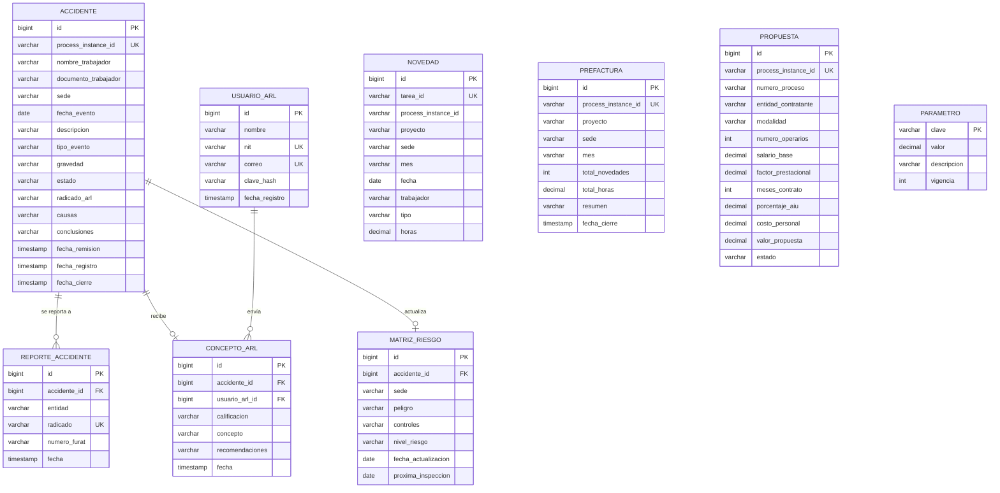

# Modelo de datos del negocio

Lo guarda el servicio de registros en su propia base H2 (`registros-db/registros`), aparte de la base de Camunda.
El script que crea las tablas es `src/main/resources/schema.sql` y el de datos iniciales es `src/main/resources/data.sql`, los dos en el repositorio ut-llano-alianza-registros. Se ejecutan en cada arranque y no borran lo que ya está guardado.

## Diagrama

NOVEDAD y PREFACTURA se relacionan por `process_instance_id`: la prefactura de un mes se arma con las novedades de la misma instancia.

## Tablas

**accidente** (proceso 1). Un registro por cada evento reportado. Lo crea el worker notificarSst.
Estados: REGISTRADO, REPORTADO, ESPERANDO_CONCEPTO_ARL, CONCEPTO_RECIBIDO y CERRADO.

**reporte_accidente** (proceso 1). Reportes a ARL y EPS (`ARL_EPS`) y al Ministerio del Trabajo (`MINTRABAJO`). El radicado lo asigna el servicio con el formato ARL-2026-000001 o MT-2026-000001. Solo puede haber un reporte por entidad para cada accidente.

**concepto_arl** (proceso 1). Lo que envía la ARL desde su portal. Uno por accidente.

**matriz_riesgo** (proceso 1). Se crea al cerrar el caso. El nivel de riesgo sale de la gravedad: grave o mortal es ALTO, leve es MEDIO, incidente es BAJO. La próxima inspección queda a los días del parámetro diasProximaInspeccion.

**usuario_arl** (usuario externo). Cuentas del portal de la ARL. La contraseña se guarda como sal + SHA-256, nunca en texto plano.

**novedad** (proceso 2). Faltas, retardos, horas extra e incapacidades. `tarea_id` es el id de la External Task, así un reintento del worker no la guarda dos veces.

**prefactura** (proceso 2). Una por instancia (un mes de una sede). Se calcula con las novedades guardadas.

**propuesta** (proceso 3). Datos de costos y valor calculado. Estados: FORMULADA y ENVIADA_RADICACION.

**parametro**. Valores de referencia. Datos iniciales:
- salarioMinimo: 1.750.905 (Decreto 1469 de 2025)
- auxilioTransporte: 249.095 (Decreto 1470 de 2025)
- diasProximaInspeccion: 30

## Vínculo con las instancias de Camunda

Las tablas accidente, novedad, prefactura y propuesta guardan el `process_instance_id` de la instancia principal. Las demás se ligan a través del accidente. Con eso:
- `GET http://localhost:8082/api/instancias/{processInstanceId}` devuelve todo lo de un caso (es lo que muestra el portal interno debajo de cada formulario).
- Desde Cockpit se puede copiar el id de una instancia y buscarlo en la base de datos.

## Consultar los datos
- API: http://localhost:8082/api/accidentes, /api/novedades, /api/prefacturas, /api/propuestas, /api/matriz-riesgos, /api/parametros
- Consola H2: http://localhost:8082/h2-console con JDBC URL `jdbc:h2:file:./registros-db/registros`, usuario `sa` y contraseña `sa`

## Empezar de cero
Detener el servicio de registros y borrar la carpeta `registros-db`. Al volver a arrancar se crean las tablas vacías con los datos iniciales.
